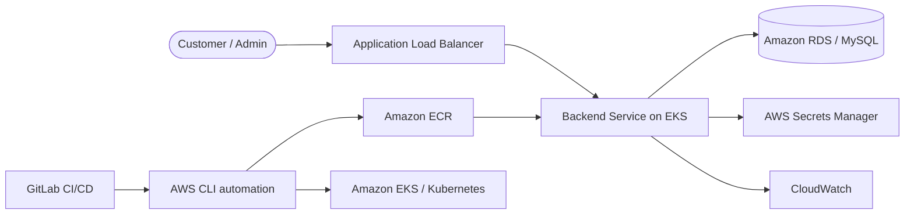

# AWS 3-Tier E-Commerce Backend — AWS CLI / CloudFormation-Track Automation

[](https://www.python.org/) [](https://www.docker.com/) [](https://aws.amazon.com/)

Flask backend for a containerized 3-tier e-commerce platform. The service is packaged with Docker and Gunicorn, published to Amazon ECR, and deployed through an AWS CLI-driven GitLab pipeline with CloudFormation integration for shared stack discovery.

> **Accuracy note:** The reviewed source contains AWS CLI orchestration and CloudFormation integration in the pipeline; no standalone CloudFormation template files were present.

## Architecture



Source: [`docs/architecture.mmd`](docs/architecture.mmd).

## Features

- Flask authentication, products, cart, orders, admin APIs, error handling, security headers, CORS, and rate limiting.
- Docker image served with Gunicorn on port 5000.
- Health endpoints for load balancer checks.
- CI/CD validation for Python syntax, Dockerfile structure, AWS identity, image build, ECR publishing, and Kubernetes rollout.
- Environment-based database, CORS, JWT, and application secret configuration.

## Local development

```bash
python -m venv .venv
source .venv/bin/activate
pip install -r requirements.txt
cp .env.example .env
python app.py
```

The application expects database and security values from the environment. Never commit the real `.env` file.

## Deployment configuration

Set `AWS_DEFAULT_REGION`, `CLUSTER_NAME`, `RDS_ENDPOINT`, `RDS_SECRET_NAME`, `APP_SECRET_NAME`, `DB_NAME`, `BACKEND_REPO`, and `IMAGE_TAG` as protected CI/CD variables. The pipeline will not create placeholder application secrets.

## Security and cost notes

Use AWS Secrets Manager, short-lived CI credentials, least-privilege IAM, private database networking, immutable image tags, and HTTPS at the load balancer. Review AWS CLI reconciliation and cleanup operations before using shared accounts. AWS services can incur charges.

## Related repositories

- [AWS 3-Tier CFT Frontend](https://github.com/pavan-007-0/aws-3tier-cft-frontend)
- [AWS 3-Tier Terraform Backend](https://github.com/pavan-007-0/aws-3tier-terraform-backend)
- [AWS 3-Tier Terraform Frontend](https://github.com/pavan-007-0/aws-3tier-terraform-frontend)
