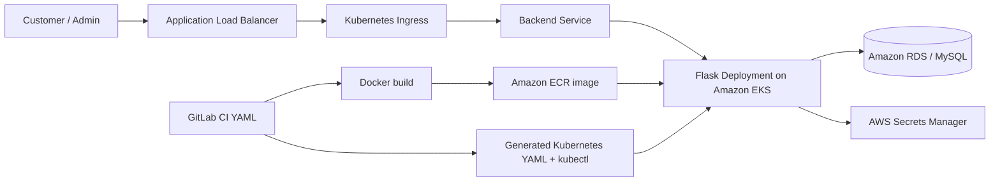

# AWS 3-Tier E-Commerce Backend on Amazon EKS with Kubernetes YAML

[](https://kubernetes.io/)
[](https://www.python.org/)
[](https://docs.gitlab.com/ee/ci/)

Containerized Flask backend for a 3-tier e-commerce platform deployed to Amazon EKS.

> **Authoring model:** Kubernetes workload manifests and the GitLab pipeline are written in YAML. The CI job uses AWS CLI commands only as deployment/runtime steps to discover the EKS/CloudFormation-provisioned environment, publish the Docker image to ECR, and apply generated Kubernetes YAML with kubectl. This repository is not presented as a Terraform or standalone CloudFormation source repository.

## Architecture



## What is authored in YAML

- `.gitlab-ci.yml` stages, variables, validation, image build, ECR publishing, and rollout commands
- Generated Kubernetes Deployment, Service, and Ingress manifests
- Environment-specific deployment values supplied through protected CI/CD variables
- Dockerfile for the Flask/Gunicorn container image

## Application capabilities

- Flask authentication, products, cart, orders, admin APIs, error handling, security headers, CORS, and rate limiting
- Gunicorn container on port 5000 with health endpoints
- Database and application secrets loaded from environment configuration
- Kubernetes rollout and load-balancer health verification

## Delivery workflow

1. GitLab CI validates Python and container configuration.
2. The job discovers the target AWS/EKS environment and obtains cluster access.
3. Docker builds the backend image and publishes it to Amazon ECR.
4. The pipeline renders deployment values into Kubernetes YAML.
5. `kubectl apply` updates the EKS Deployment, Service, and Ingress.
6. Rollout status and the backend endpoint are checked.

## Technology keywords

`Kubernetes YAML` · `GitLab CI YAML` · `Amazon EKS` · `kubectl` · `Amazon ECR` · `AWS CLI in CI` · `Docker` · `Python` · `Flask` · `Gunicorn` · `Amazon RDS` · `Secrets Manager` · `Application Load Balancer`

## Local development

```bash
python -m venv .venv
source .venv/bin/activate
pip install -r requirements.txt
cp .env.example .env
python app.py
```

Never commit real credentials, `.env` files, generated logs, or database secrets. Configure deployment values as protected GitLab CI/CD variables.

## Related repositories

- [Kubernetes YAML frontend](https://github.com/pavan-007-0/aws-3tier-cft-frontend)
- [Terraform/HCL backend](https://github.com/pavan-007-0/aws-3tier-terraform-backend)
- [Terraform/HCL frontend](https://github.com/pavan-007-0/aws-3tier-terraform-frontend)
- ECS/CloudFormation repositories are documented separately under the `aws-3tier-cloudformation-ecs-*` naming convention.
